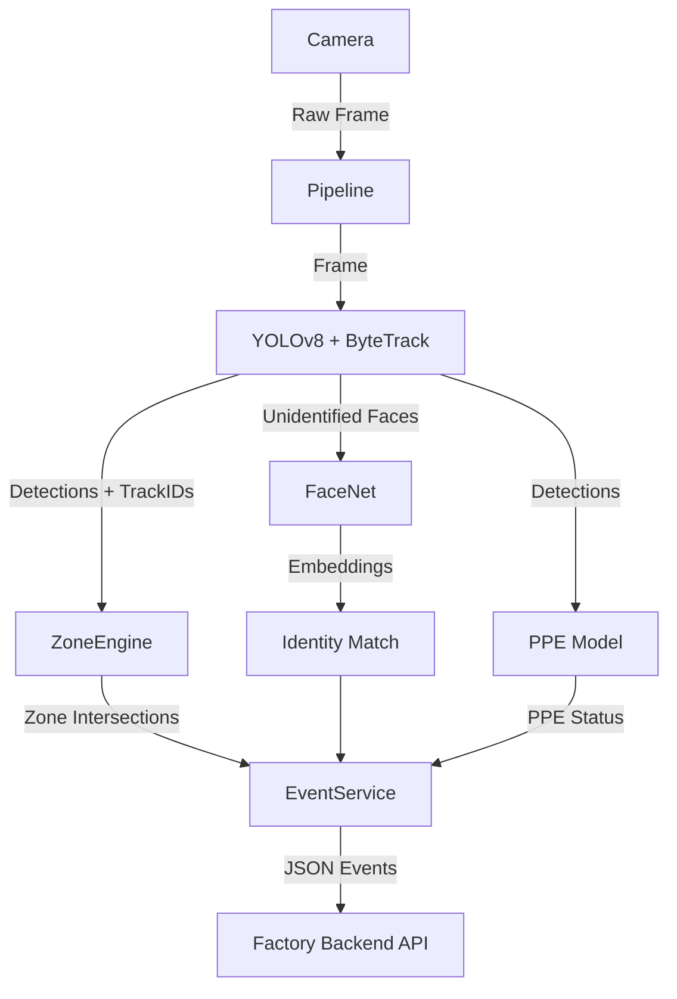

# Architecture Overview

The AI Engine for the Factory Monitoring Platform is designed as a modular, real-time video processing pipeline wrapped in a FastAPI web service.

## Core Components

1. **Video Source (`app.core.pipeline`)**: 
   - Abstracts the input mechanism (Webcam, File, RTSP).
   - Yields `Frame` objects.

2. **Inference Pipeline (`app.services.inference_service`)**:
   - Manages the execution of AI models on each frame.
   - Responsible for throttling (e.g., face recognition is not run on every frame).

3. **AI Models (`app.models.*`)**:
   - `detector.py`: Person & Vehicle detection via YOLO. Includes ByteTrack.
   - `ppe.py`: Specialized PPE detection via YOLO.
   - `face.py`: Face detection (MTCNN) and embedding (FaceNet/InceptionResnet).

4. **Tracking (`app.tracking.*`)**:
   - Handled natively by the YOLO tracker output or custom tracking logic.
   - Maintains state across frames to limit expensive computations (like face recognition) to only "new" or "unidentified" tracks.

5. **Zone Engine (`app.zones.*`)**:
   - Evaluates the bottom-center point of bounding boxes against defined polygons (zones).
   - Triggers basic events based on state changes (e.g., inside -> outside).

6. **Event Generation (`app.core.events`)**:
   - Translates raw AI/Zone logic into business-friendly unified JSON events.
   - e.g., `PERSON_ENTERED_ZONE`, `UNAUTHORIZED_ZONE_ENTRY`.

7. **API Layer (`app.main`)**:
   - REST endpoints for configuration, zone setup, and one-off image tests.
   - WebSocket endpoint (`/ws/live`) for streaming annotated frames and live events to the frontend.

## Data Flow

